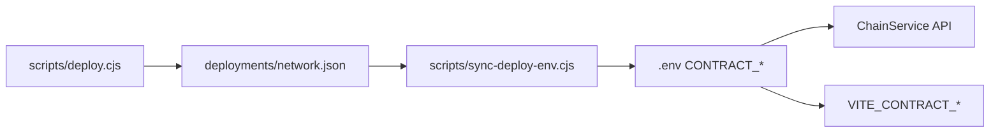

# Smart contracts

Código em [`apps/contracts/`](../../apps/contracts/). Rede alvo: **Polygon** (137) e **Polygon Amoy** (80002) para testes.

---

## Contratos

| Arquivo | Propósito |
|---------|-----------|
| `MGTToken.sol` | Token ERC20 do ecossistema (MGT) |
| `MLLPlayerNFT.sol` | NFT ERC721 dos jogadores |
| `ScoutEngine.sol` | Mint on-chain com Chainlink VRF |
| `Marketplace.sol` | Listagem e compra de NFTs |
| `BurnEngine.sol` | Queima/fusão de jogadores |
| `StakingVault.sol` | Staking de MGT |
| `RewardsPool.sol` | Pool de recompensas |
| `USDCPlayerVault.sol` | Depósito/saque USDC custodiado |
| `MockUSDC.sol` | USDC mock para testes locais |

Stack: **Solidity 0.8.26**, **OpenZeppelin 5**, **Chainlink VRF** (ScoutEngine), compilador com `viaIR` e optimizer 200 runs.

---

## Redes

| Rede | Chain ID | Config Hardhat |
|------|----------|----------------|
| hardhat (local) | 31337 | `hardhat node` |
| localhost | 31337 | `http://127.0.0.1:8545` |
| Amoy (testnet) | 80002 | Alchemy RPC |
| Polygon (mainnet) | 137 | Alchemy RPC |

Config: [`apps/contracts/hardhat.config.cjs`](../../apps/contracts/hardhat.config.cjs).

Variáveis: `DEPLOYER_PRIVATE_KEY`, `ALCHEMY_API_KEY`, `POLYGONSCAN_API_KEY`.

---

## Fluxo de deploy

| Comando | Ação |
|---------|------|
| `npm run deploy:local -w @mll/contracts` | Deploy em Hardhat local |
| `npm run deploy:amoy -w @mll/contracts` | Deploy em Amoy |
| `npm run deploy:polygon -w @mll/contracts` | Deploy em Polygon |
| `npm run sync:contracts:env hardhat` | Sincroniza endereços para `.env` |
| `npm test -w @mll/contracts` | Testes Hardhat |
| `npm run coverage -w @mll/contracts` | Coverage Solidity |

Manifests salvos em `apps/contracts/deployments/`.

---

## Integração com o backend

### Fase 1 (atual) — off-chain first

Conforme [ADR-0012](../adr/0012-scout-off-chain-phase-1.md) e [ADR-0005](../adr/0005-disable-web3-auth-phase-1.md):

- **Scout** via API (`POST /api/scout/mint`) — sem transação on-chain
- **Auth** email/senha — Web3 auth retorna `501`
- **Economia** em ledger Postgres (`MGTBalance`) denominada USDC
- Contratos podem estar deployados mas não são obrigatórios para jogar

### Fase 2 — on-chain híbrido

Quando `CONTRACT_*` e RPC estão configurados:

1. `ChainService` (API, `ethers` 6) escuta eventos on-chain
2. Eventos enfileirados na fila `chain-indexer` (BullMQ)
3. Worker processa: mint NFT → `PlayerCache`, depósito vault → `WalletTransaction` + referral

Eventos definidos em [`packages/shared/src/chain-events.ts`](../../packages/shared/src/chain-events.ts):

- `PlayerMinted`, `PlayerBurned`, `PlayersFused`
- `ItemListed`, `ItemSold`
- `UsdcDeposited`, `UsdcWithdrawn`

### Frontend Web3

`wagmi` + `viem` instalados em `apps/web` mas desligados na fase 1. Variáveis `VITE_CONTRACT_*` e `VITE_WC_PROJECT_ID` para ativação futura.

---

## Testes

Testes em `apps/contracts/test/` (Chai + Hardhat):

- `MGTToken.test.cjs`
- `USDCPlayerVault.test.cjs`

CI roda `npm run test:contracts` no workflow GitHub Actions.

---

## Segurança

- `DEPLOYER_PRIVATE_KEY` e `GAME_ROLE_KEY` nunca commitar — só em `.env` / secrets CI
- Contratos usam OpenZeppelin `AccessControl` para roles (`GAME_ROLE`, etc.)
- Verificação Polygonscan: `npm run verify -w @mll/contracts`
