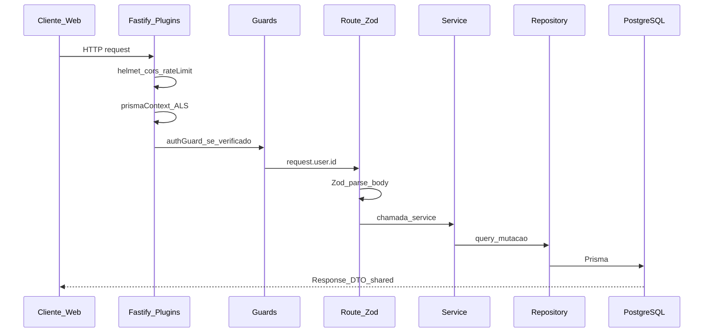
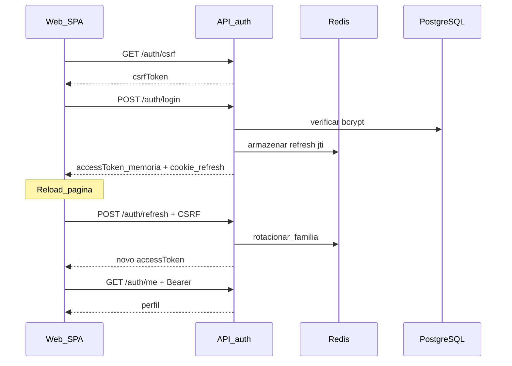
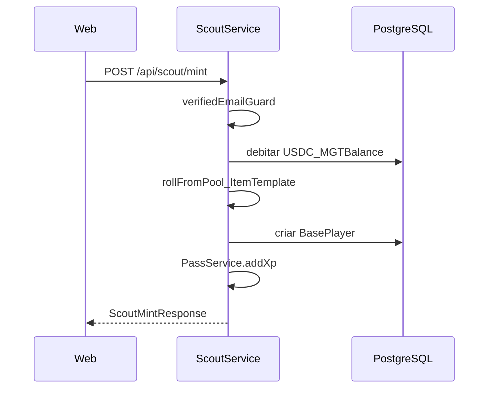
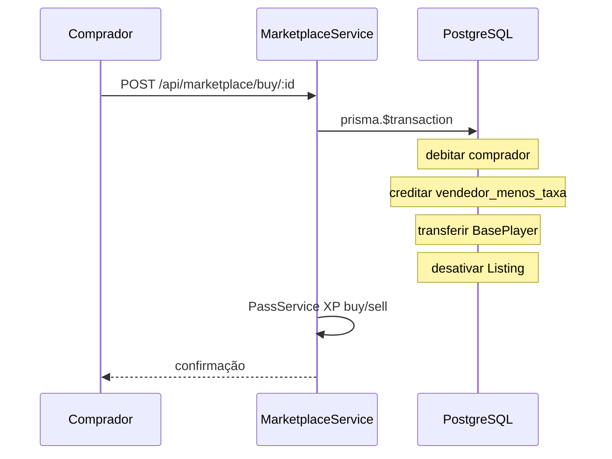
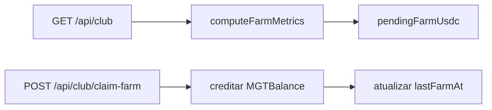
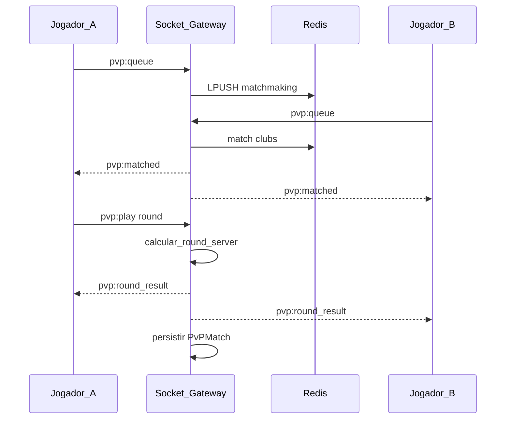
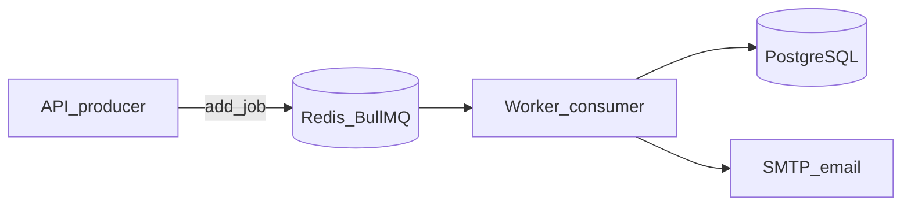
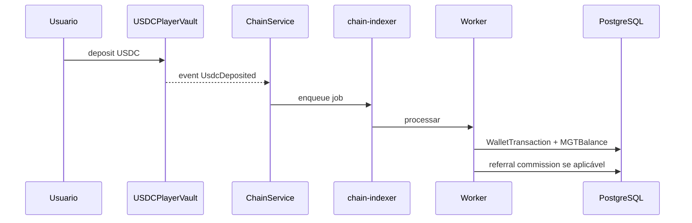

# Fluxos de dados

Como requests e jobs atravessam o sistema. Invariantes de segurança: [`../security/invariants.md`](../security/invariants.md).

---

## 1. Request HTTP padrão

**Camadas:**
1. **Plugins** (`apps/api/src/plugins/`) — segurança, contexto Prisma ALS, Redis, JWT
2. **Guards** — `authGuard` global em `/api/*`; `verifiedEmailGuard` em scout/marketplace
3. **Route** — valida com schema Zod de `@mll/shared`
4. **Service** — regras de negócio, `GAME_CONFIG`, transações
5. **Repository** — único ponto de acesso Prisma por módulo

Erros Zod → `{ error: { code: 'VALIDATION_ERROR' } }`. Erros de domínio usam `ErrorCode` de `@mll/shared`.

---

## 2. Autenticação (jogador)

- Access token: **memória apenas** (`apps/web/src/lib/auth/storage.ts`)
- Refresh token: cookie `httpOnly`, `sameSite: lax`, rotação com detecção de reuso
- Detalhes: [ADR-0006](../adr/0006-refresh-token-rotation-redis.md), [ADR-0009](../adr/0009-csrf-cookie-routes.md)

---

## 3. Scout mint (off-chain)

- RNG server-side a partir do pool `ItemTemplate` ativo
- Custo: `SCOUT_COST_USDC` (2 USDC) × quantidade
- Fase 1: sem transação blockchain — [ADR-0012](../adr/0012-scout-off-chain-phase-1.md)

---

## 4. Marketplace buy

- Taxa: `MARKETPLACE_FEE_BPS` (1000 = 10%)
- Operação atômica — falha parcial impossível

---

## 5. Farm idle

Fórmula: `sumTop11(overwall) × stadiumFactor × FARM_OVERWALL_FACTOR` USDC/hora.

- Máximo 24h acumulável (`FARM_MAX_OFFLINE_HOURS`)
- Implementação: [`game.ts`](../../apps/api/src/config/game.ts) — `calculateUsdcPerHour()`, `sumTop11Overwall()`

---

## 6. PvP (Socket.IO)

HTTP `POST /api/pvp/match` retorna 501. Fluxo real:

Detalhes: [`realtime.md`](./realtime.md).

---

## 7. Job BullMQ

| Fila | Trigger | Efeito |
|------|---------|--------|
| `email` | API (registro, reset, 2FA) | Nodemailer envia |
| `stamina-recovery` | Cron 10min | Restaura stamina (CT level) |
| `season-reset` | Cron 24h | Desativa temporada expirada |
| `mining` | Cron N min | Distribui USDC por overwall |
| `chain-indexer` | ChainService event | Sync on-chain → Postgres |
| `referral-rewards` | Depósito/MGT credit | Comissão 5% ao referrer |

Worker: [`apps/worker/src/workers/index.ts`](../../apps/worker/src/workers/index.ts).

---

## 8. Depósito on-chain (quando configurado)

Requer `CONTRACT_USDC_VAULT`, `POLYGON_RPC_URL` e wallet do usuário linkada.

---

## Princípio server-authoritative

O cliente envia **ações** (`mint`, `buy`, `upgrade`), nunca valores monetários ou recompensas. Toda elegibilidade, preço e payout é calculada no service com `GAME_CONFIG` e estado do banco.
