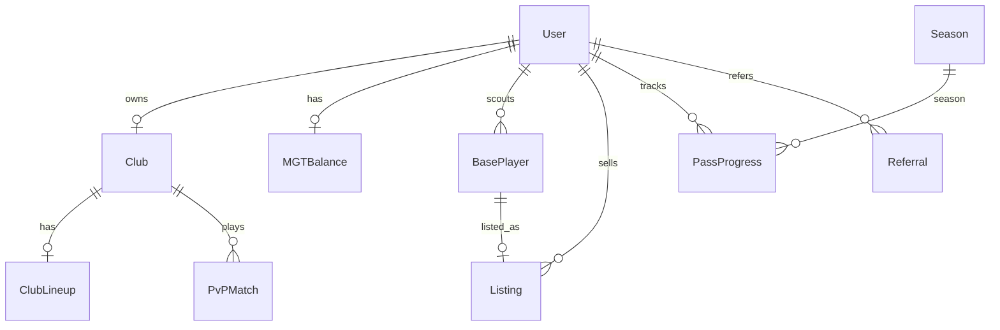

# Banco de dados e persistência

Fonte da verdade do schema: [`apps/api/prisma/schema.prisma`](../../apps/api/prisma/schema.prisma).

API e worker compartilham o mesmo Prisma Client gerado a partir desse schema. Migrations em `apps/api/prisma/migrations/`.

---

## Visão por domínio

### Identidade e auth

| Modelo | Propósito |
|--------|-----------|
| `User` | Conta (email, username, wallet opcional, referral code, lockout, ban) |
| `EmailVerificationToken` | Verificação de email (hash SHA-256, TTL) |
| `PasswordResetToken` | Reset de senha (uso único, TTL 30min) |
| `AuditLog` | Trilha de auditoria (ações, IP, meta JSON) |

### Clube e jogadores

| Modelo | Propósito |
|--------|-----------|
| `Club` | Um clube por usuário — níveis de edifícios, `totalOverwall`, `lastFarmAt` |
| `BasePlayer` | Jogadores off-chain (fase 1) — raridade, overwall, posição, stamina |
| `PlayerCache` | Espelho de NFTs on-chain (`tokenId` bigint) |
| `ItemTemplate` | Pool admin para scout (imagem, stats, peso) |
| `ClubLineup` | Vestiário — template de estádio + assignments JSON |
| `StadiumTemplate` | Templates visuais de estádio |
| `StadiumShopItem` | Itens compráveis na loja do estádio |

### Economia

| Modelo | Propósito |
|--------|-----------|
| `MGTBalance` | Saldo USDC off-chain (nome legado MGT) |
| `MGTTransaction` | Ledger append-only de créditos/débitos |
| `WalletTransaction` | Depósitos/saques on-chain auditados por `txHash` |
| `WithdrawalRequest` | Saques pendentes de aprovação admin |
| `Listing` | Marketplace — `basePlayerId` ou `tokenId` |
| `Stake` | Staking (fase on-chain futura) |
| `PlatformConfig` | Toggles globais (saques, mining, registro, referral %) |
| `MiningBlock` / `MiningReward` / `MiningBalance` | Mining periódico por overwall |

### Progressão e social

| Modelo | Propósito |
|--------|-----------|
| `Season` / `PassProgress` | Passe de temporada (XP, premium, níveis claimados) |
| `PvPMatch` | Histórico de partidas PvP |
| `Referral` | Referrer ↔ referred + comissões acumuladas |
| `YoutubeCreator` / `YoutubeVideo` | Programa de criadores |
| `SiteAnnouncement` / `UserAnnouncementDismissal` | Anúncios do site |
| `SupportTicket` / `SupportMessage` / `SupportAttachment` | Suporte com anexos |

---

## Relações chave

**Regras:**
- `User.club` é 1:1 — um clube por conta
- `BasePlayer.listing` é 1:1 opcional — jogador listado no marketplace
- `Listing` aceita `basePlayerId` (off-chain) **ou** `tokenId` (on-chain), nunca ambos
- Valores monetários usam `Decimal` — nunca `Number()` antes de operações Prisma

---

## O que fica onde

| Dado | PostgreSQL | Redis | MongoDB |
|------|------------|-------|---------|
| Estado de jogo | Sim | — | — |
| Saldo USDC | Sim (`MGTBalance`) | — | — |
| Refresh tokens | Metadados família | Sim (jti, used, revoke) | — |
| Rate limits | — | Sim | — |
| Fila PvP matchmaking | — | Sim (list) | — |
| Jobs BullMQ | — | Sim | — |
| Socket.IO rooms (multi-instância) | — | Sim (adapter) | — |
| Logs operacionais | — | — | Sim (TTL 90d default) |

---

## Comandos

| Script (raiz) | Ação |
|---------------|------|
| `npm run db:generate` | Gera `@prisma/client` |
| `npm run db:migrate` | `migrate deploy` (CI/prod) |
| `npm run db:migrate:dev` | `migrate dev` (local, cria migration) |
| `npm run db:seed` | Seed demo (`apps/api/prisma/seed.ts`) |
| `npm run db:studio` | Prisma Studio GUI |

O `postinstall` da raiz roda `db:generate` automaticamente.

---

## Guard Prisma (ALS)

Rotas HTTP usam AsyncLocalStorage para restringir queries por contexto (`player`, `admin`, `system`, `blocked`). Detalhes em [`../security/invariants.md`](../security/invariants.md) §4.

O **worker** usa `PrismaClient` próprio, fora do guard ALS — jobs rodam com acesso total ao schema (confiança no código do worker).

---

## Convenções

- IDs: `uuid()` para entidades de domínio; `tokenId` e `blockNumber` como `BigInt`
- Timestamps: `createdAt` / `updatedAt` automáticos onde aplicável
- Índices compostos em queries frequentes (marketplace, audit, support)
- Não duplicar definições de campos aqui — consultar `schema.prisma` para tipos exatos
