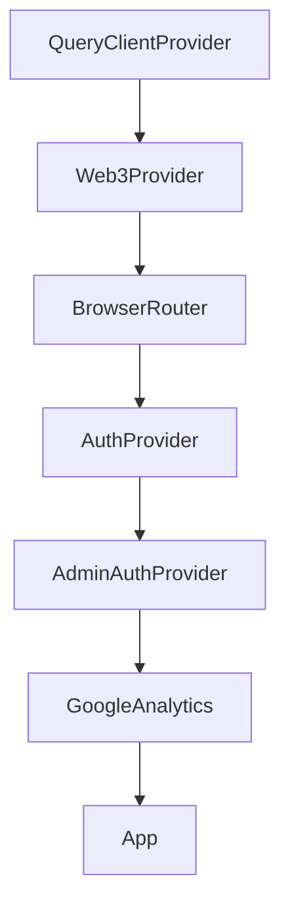

# Frontend — `apps/web`

SPA **React 19** + **Vite 5**. Estilo pixel-art, i18n em 3 idiomas.

Entry: [`index.html`](../../apps/web/index.html) → [`src/main.tsx`](../../apps/web/src/main.tsx) → [`src/App.tsx`](../../apps/web/src/App.tsx).

---

## Estrutura de diretórios

```
apps/web/src/
├── main.tsx           # Bootstrap + providers
├── App.tsx            # Definição de rotas
├── app/               # Páginas (espelham features)
├── components/        # UI reutilizável por feature
├── hooks/             # useAuth, useApi, useSocket, usePvP, ...
├── lib/               # api client, auth storage, web3, socket
├── i18n/              # locales pt-BR, en, es
└── styles/            # globals.css (Tailwind)
```

Convenção: cada página em `app/<feature>/page.tsx`. Componentes específicos em `components/<feature>/`.

---

## Providers (bootstrap)

Ordem em `main.tsx`:



| Provider | Arquivo | Papel |
|----------|---------|-------|
| QueryClient | `main.tsx` | TanStack Query (staleTime 30s) |
| Web3Provider | `lib/web3/Web3Provider.tsx` | wagmi (desligado fase 1) |
| AuthProvider | `hooks/useAuth.tsx` | Sessão jogador |
| AdminAuthProvider | `hooks/useAdminAuth.tsx` | Sessão admin separada |

Ao carregar: `GET /auth/csrf` → `POST /auth/refresh` → `GET /auth/me`.

---

## Rotas

### Públicas (sem login)

| Path | Página |
|------|--------|
| `/` | Landing |
| `/login`, `/register` | Auth |
| `/auth/forgot-password`, `/auth/reset-password`, `/auth/verify-email` | Fluxos auth |
| `/roadmap`, `/whitepaper` | Conteúdo |
| `/legal/*` | Termos, privacidade, cookies, web3-risk, community |

### Jogador (ProtectedRoute)

| Path | Feature |
|------|---------|
| `/club` | Clube principal (+ aliases `/club/ct`, `/treasurer`, `/trophies`) |
| `/club/inventory` | Inventário |
| `/club/stadium` | Estádio (canvas) |
| `/club/vestiario` | Lineup |
| `/scout` | Scout mint |
| `/marketplace` | Marketplace |
| `/pvp` | PvP |
| `/pass` | Passe de temporada |
| `/wallet` | Carteira USDC |
| `/mining` | Mining |
| `/referrals` | Indicações |
| `/ranking` | Leaderboard |
| `/minigames` | Minigames |
| `/settings` | Configurações |
| `/support` | Suporte |

### Admin (ProtectedAdminRoute + AdminLayout)

| Path | Área |
|------|------|
| `/admin/login`, `/admin/verify-2fa` | Auth admin |
| `/admin` | Dashboard |
| `/admin/users`, `/admin/users/:id` | Usuários |
| `/admin/withdrawals` | Saques |
| `/admin/wallet` | Treasury |
| `/admin/pass` | Temporada |
| `/admin/items` | Pool scout |
| `/admin/stadiums`, `/admin/stadium-shop` | Estádio |
| `/admin/referrals` | Referrals |
| `/admin/social` | YouTube |
| `/admin/announcements` | Anúncios |
| `/admin/support` | Tickets |
| `/admin/audit` | Auditoria |
| `/admin/settings` | Platform config |
| `/admin/reports` | Relatórios |

---

## Data fetching

### HTTP client

[`lib/api/client.ts`](../../apps/web/src/lib/api/client.ts):

- Base URL: `VITE_API_URL` (default `http://localhost:3001`)
- Interceptor: anexa `Authorization: Bearer` do storage em memória
- Interceptor 401: tenta refresh automático, depois redirect login
- CSRF: header `X-CSRF-Token` em rotas com cookie

### TanStack Query

[`hooks/useApi.ts`](../../apps/web/src/hooks/useApi.ts) — hooks por domínio:

| Hook pattern | Query key exemplo |
|--------------|-------------------|
| `useClub()` | `['club', userId]` |
| `useInventory()` | `['inventory', userId]` |
| `useMarketplace()` | `['marketplace', filters]` |
| `useWallet()` | `['wallet', userId]` |

Mutations invalidam keys relacionadas no `onSuccess`.

**Sem Redux/Zustand** — estado local em componentes + cache React Query.

---

## Realtime

| Hook | Uso |
|------|-----|
| `useSocket` | Conexão Socket.IO autenticada |
| `usePvP` | Fila, match, rounds |
| `useNotifications` | Notificações 1:1 |

Socket path: `VITE_SOCKET_PATH` (default `/socket.io`). JWT enviado no handshake.

Detalhes backend: [`realtime.md`](./realtime.md).

---

## i18n

- Biblioteca: `i18next` + `react-i18next`
- Locales: `src/i18n/locales/{pt-BR,en,es}/`
- Detecção automática de idioma do browser
- Chaves organizadas por feature (`club.*`, `scout.*`, etc.)

---

## Estilos

- **Tailwind CSS 3** — `tailwind.config.js`, `postcss.config.js`
- **Framer Motion** — transições e animações
- **bootstrap-icons** — ícones
- Tema pixel-art em `styles/globals.css`

---

## Web3 (fase 2)

`lib/web3/` contém config wagmi/viem. Desligado na fase 1 ([ADR-0005](../adr/0005-disable-web3-auth-phase-1.md)).

Variáveis: `VITE_CHAIN_ID`, `VITE_RPC_URL`, `VITE_CONTRACT_*`, `VITE_WC_PROJECT_ID`.

---

## Build e deploy

| Comando | Resultado |
|---------|-----------|
| `npm run dev -w @mll/web` | Dev server porta **5173** |
| `npm run build -w @mll/web` | `dist/` estático |
| Docker | nginx serve `dist/` na porta **15000**, proxy API |

Config nginx: [`apps/web/nginx.conf`](../../apps/web/nginx.conf).

---

## Testes

Vitest + Testing Library em `apps/web/tests/`. Componentes e hooks testados com jsdom.

Ver [`../testing.md`](../testing.md).
