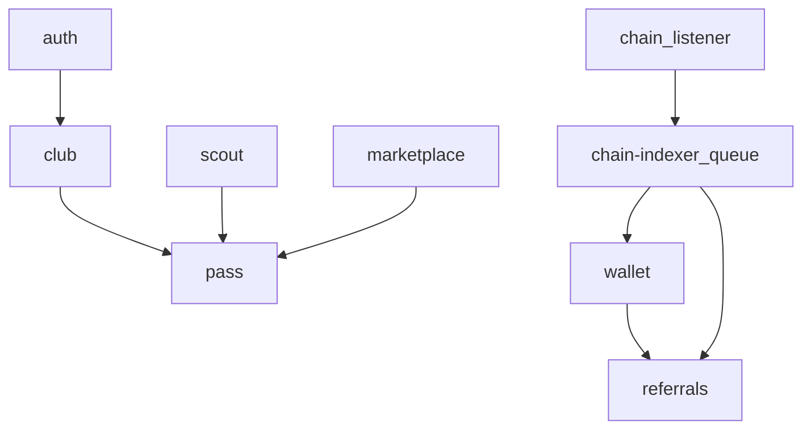

# Módulos backend

Padrão por feature em `apps/api/src/modules/<nome>/`:

```
<feature>/
├── <feature>.routes.ts    # HTTP wiring + Zod
├── <feature>.service.ts   # Regras de negócio
└── <feature>.repository.ts  # Prisma (quando necessário)
```

Registro central: [`apps/api/src/app.ts`](../../apps/api/src/app.ts).

---

## Mapa de prefixos

| Módulo | Prefixo HTTP | Auth | Descrição |
|--------|--------------|------|-----------|
| `auth` | `/auth` | Público (exceto `/me`, `/logout`) | Registro, login, refresh, CSRF, reset senha |
| `stats` | `/stats` | Público | Leaderboard e estatísticas |
| `club` | `/api/club` | JWT | Clube, inventário, upgrades, farm |
| `stadium` (player) | `/api/stadium` | JWT | Layout e manutenção do estádio |
| `stadium-shop` | `/api/stadium` | JWT | Loja de itens do estádio |
| `vestiario` | `/api/vestiario` | JWT | Lineup / vestiário + descanso diário |
| `ct` | `/api/ct` | JWT | Hub CT (status, upgrade, stamina do elenco) |
| `minigames` | `/api/minigames` | JWT | Minigames de recuperação de stamina |
| `stamina` | (service) | — | Domínio central de mutações de stamina |
| `marketplace` | `/api/marketplace` | JWT + email verificado | Listar, comprar, buscar |
| `pvp` | `/api/pvp` | JWT | HTTP stub; matchmaking via Socket.IO |
| `pass` | `/api/pass` | JWT | Passe de temporada |
| `referrals` | `/api/referrals` | JWT | Código e ganhos de referral |
| `scout` | `/api/scout` | JWT + email verificado | Mint off-chain |
| `merger` | `/api/merger` | JWT | Fusão off-chain 10→1 (BasePlayer) |
| `wallet` | `/api/wallet` | JWT | Saldo, depósitos, saques |
| `mining` | `/api/mining` | JWT | Blocos e recompensas mining |
| `announcements` | `/api/announcements` | JWT | Anúncios ativos + dismiss |
| `support` | `/api/support` | JWT | Tickets com anexos |
| `social` | `/api/social` | JWT | Programa YouTube creators |
| `admin` | `/admin/api` | Admin JWT + 2FA | Painel operacional |
| `items` (admin) | `/admin/api/items` | Admin | Templates de scout |
| `stadium` (admin) | `/admin/api/stadiums` | Admin | Templates de estádio |
| `stadium-shop` (admin) | `/admin/api/stadium-shop` | Admin | CRUD loja estádio |

Todas as rotas `/api/*` recebem `authGuard` global via hook `onRoute` — módulos não repetem o guard.

---

## Detalhamento por módulo

### `auth`

**Arquivos:** `auth.routes.ts`, `auth.service.ts`, `tokens/refresh-token.service.ts`

| Rota | Método | Notas |
|------|--------|-------|
| `/auth/csrf` | GET | Token CSRF para refresh/logout |
| `/auth/register` | POST | Turnstile se configurado |
| `/auth/login` | POST | Rate limit 5/min |
| `/auth/refresh` | POST | Cookie httpOnly + CSRF |
| `/auth/logout` | POST | Revoga família refresh |
| `/auth/me` | GET | Perfil autenticado |
| `/auth/verify-email` | POST | Consome token hash |
| `/auth/forgot-password` | POST | Sempre 200 (anti-enumeration) |
| `/auth/reset-password` | POST | Revoga todas famílias refresh |
| `/auth/nonce`, `/auth/verify` | POST | **501** — Web3 desabilitado (ADR-0005) |

**Dependências:** Redis (refresh), Prisma (`User`), fila `email`.

---

### `club`

**Arquivos:** `club.routes.ts`, `club.service.ts`, `club.repository.ts`

| Rota | Ação |
|------|------|
| `GET /` | Clube + métricas farm |
| `POST /create` | Criar clube (nome único) |
| `GET /inventory` | Jogadores do usuário |
| `POST /upgrade/:building` | Upgrade estádio/CT/tesoureiro/troféus |
| `POST /claim-farm` | Creditar farm idle (drena stamina dos titulares) |

**Dependências:** `PassService` (XP), `GAME_CONFIG`, fila email opcional.

**Edifícios:** `stadium`, `ct`, `treasurer`, `trophyRoom` — custo via `calculateUpgradeCost()`.

---

### `scout`

**Arquivos:** `scout.routes.ts`, `scout.service.ts`

| Rota | Ação |
|------|------|
| `POST /mint` | Gacha off-chain de `BasePlayer` |

**Dependências:** `ItemTemplate` (pool admin), ledger USDC, `PassService`, `verifiedEmailGuard`.

Distribuição de raridade: `GAME_CONFIG.RARITY_DISTRIBUTION` em [`game.ts`](../../apps/api/src/config/game.ts).

---

### `merger`

**Arquivos:** `merger.routes.ts`, `merger.service.ts`, `merger.repository.ts`

| Rota | Ação |
|------|------|
| `GET /rules` | Constantes públicas (`inputCount: 10`, tiers, taxa 0) |
| `POST /fuse` | Queima 10 `BasePlayer` mesma raridade → 1 raridade+1 |

**Validações:** dono do clube, `kind` base, não listados, fora da escalação, raridade &lt; lendário.

**Dependências:** `ClubRepository`, `StadiumRepository` (lineup), `ItemTemplateService` (visual), `PassService` (XP opcional).

Overwall do resultado: `rollMergeOverwall()` — faixas alinhadas a `BurnEngine.overwallRanges`.

---

### `marketplace`

| Rota | Ação |
|------|------|
| `GET /` | Listagens ativas (filtros) |
| `POST /list` | Listar `BasePlayer` |
| `POST /buy/:id` | Compra atômica (taxa 10% = 1000 bps) |
| `DELETE /list/:id` | Cancelar listagem |

**Dependências:** `PassService` (XP buy/sell), transação Prisma atômica.

---

### `wallet`

| Rota | Ação |
|------|------|
| `GET /balance` | Saldo USDC |
| `GET /transactions` | Histórico ledger + on-chain |
| `POST /withdraw` | Solicitar saque (admin aprova) |
| `GET /deposit-info` | Endereço vault + instruções |

**Dependências:** `PlatformConfig` (mínimos, pausa), `WithdrawalRequest`.

---

### `mining`

| Rota | Ação |
|------|------|
| `GET /status` | Estado atual + próximo bloco |
| `GET /history` | Blocos e recompensas do usuário |
| `GET /leaderboard` | Ranking por overwall |

**Worker:** fila `mining` — distribui USDC proporcional ao overwall (intervalo em `PlatformConfig.miningBlockIntervalMin`).

---

### `pass`

| Rota | Ação |
|------|------|
| `GET /` | Temporada ativa + progresso |
| `POST /claim/:level` | Resgatar recompensa de nível |
| `POST /premium` | Comprar passe premium (500 USDC) |

**Worker:** fila `season-reset` — desativa temporada expirada (cron diário).

---

### `pvp`

| Rota | Ação |
|------|------|
| `POST /match` | **501** — usar Socket.IO |

Matchmaking real: [`gateway/pvp.room.ts`](../../apps/api/src/gateway/pvp.room.ts). Ver [`realtime.md`](./realtime.md).

---

### `vestiario` / `stadium` / `stadium-shop` / `ct` / `minigames`

- **Vestiário:** lineup com `StadiumTemplate` + assignments; `POST /rest` descanso diário
- **CT:** `GET /` agrega nível, taxa passiva, upgrade e resumo de stamina
- **Minigames:** `GET /` catálogo; `POST /:id/play` recupera +15 stamina (1x/dia/jogo)
- **Stadium (player):** canvas de manutenção, estado visual
- **Stadium shop:** consumíveis de stamina com USDC
- **StaminaService:** `consumeLineup`, `applyDelta`, gates PvP e drain no farm claim

Admin gerencia templates em rotas `/admin/api/stadiums` e `/admin/api/stadium-shop`.

---

### `referrals`

| Rota | Ação |
|------|------|
| `GET /` | Código do usuário + ganhos + indicados |

**Worker:** fila `referral-rewards` — comissão 5% em depósitos/MGT creditados.

---

### `support`

Tickets com mensagens e anexos de imagem (sharp + validação MIME). Admin responde via `/admin/api/support`.

---

### `social`

Programa de criadores YouTube: inscrição, submissão de vídeos, moderação admin.

---

### `announcements`

Anúncios dismissíveis no site. Admin CRUD em `/admin/api/announcements`.

---

### `stats`

Endpoints públicos de ranking/estatísticas (sem JWT).

---

### `admin`

Dois registradores:

1. **`admin.routes.ts`** — auth admin: login, 2FA, refresh, logout, CSRF
2. **`admin-panel.routes.ts`** — CRUD operacional

| Área admin | Funções |
|------------|---------|
| Users | Listar, ban, detalhe, ajuste saldo |
| Withdrawals | Aprovar/rejeitar saques |
| Pass | Configurar temporada e níveis |
| Items | Pool de scout (`ItemTemplate`) |
| Stadiums / Shop | Templates e itens |
| Referrals | Visão global |
| Social | Moderar criadores/vídeos |
| Support | Responder tickets |
| Audit | Logs de auditoria |
| Settings | `PlatformConfig` |
| Wallet | Operações treasury |

Auth: operadores em `ADMIN_USERS` (env), JWT separado (`ADMIN_JWT_SECRET`), 2FA por email — [ADR-0013](../adr/0013-env-based-admin-auth.md).

---

## Componentes transversais (não são módulos HTTP)

| Componente | Path | Papel |
|------------|------|-------|
| Socket gateway | `gateway/socket.ts` | PvP, presence, notificações |
| ChainService | `modules/chain/` | Listener ethers → fila `chain-indexer` |
| Plugins | `plugins/` | prisma, redis, jwt, csrf, cors, helmet, rateLimit, sentry, bullBoard, uploads |
| Guards | `common/guards/` | auth, verifiedEmail, admin |
| Game config | `config/game.ts` | Constantes e fórmulas econômicas |

---

## Filas BullMQ

Definidas em [`packages/shared/src/queues.ts`](../../packages/shared/src/queues.ts):

| Fila | Producer | Consumer |
|------|----------|----------|
| `email` | API | Worker |
| `stamina-recovery` | Worker (cron 10min) | Worker |
| `season-reset` | Worker (cron 24h) | Worker |
| `chain-indexer` | API (ChainService) | Worker |
| `referral-rewards` | API / Worker | Worker |
| `mining` | Worker (cron configurável) | Worker |

---

## Dependências entre módulos



**Regra:** módulos importam *services* de outros módulos, nunca repositories ou `app.prisma` diretamente — [ADR-0004](../adr/0004-feature-based-layering.md).
