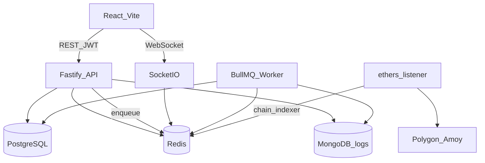

# Master Legends League — Arquitetura

## Visão geral

Monólito modular em TypeScript, organizado como **monorepo npm workspaces** (4 apps + 2 pacotes compartilhados).

| App / pacote | Papel |
|--------------|-------|
| `apps/api` | HTTP (Fastify 5) + Socket.IO gateway; enfileira jobs BullMQ |
| `apps/worker` | Consumers BullMQ (email, crons, chain-indexer, referral-rewards) |
| `apps/web` | SPA React 19 + Vite |
| `apps/contracts` | Smart contracts Hardhat (Polygon / Amoy) |
| `packages/shared` | Zod, `ErrorCode`, filas BullMQ, eventos chain, email templates, DTOs de resposta |
| `packages/logging` | Pino + sink MongoDB (logs operacionais) |

**Princípio:** o servidor é a fonte da verdade. Custos, recompensas e elegibilidade vêm de regras server-side — ver [`docs/security/invariants.md`](../security/invariants.md) e ADRs em [`docs/adr/`](../adr/).

---

## Estrutura de diretórios

```
├── apps/
│   ├── api/           # Fastify + Prisma + Socket.IO
│   ├── worker/        # BullMQ workers
│   ├── web/           # React + Vite SPA
│   └── contracts/     # Solidity + Hardhat
├── packages/
│   ├── shared/        # Zod + tipos compartilhados
│   └── logging/       # Pino + Mongo sink
├── docs/              # ADRs, arquitetura, segurança
├── docker-compose.yml # Stack completa (prod-like)
└── vitest.workspace.ts
```

---

## Stack por camada

### API (`apps/api`)

| Tecnologia | Uso |
|------------|-----|
| Fastify 5 | HTTP modular (`routes → service → repository`) |
| Prisma 5 + PostgreSQL 15 | Domínio, audit (`AuditLog`) |
| Redis 7 | Refresh tokens, rate limit, fila PvP, BullMQ producer |
| BullMQ | Email, chain-indexer, referral-rewards |
| Socket.IO + Redis adapter | PvP matchmaking, presence |
| JWT + bcrypt + CSRF | Auth email-first (ADR-0005) |
| ethers 6 | Chain listener → fila `chain-indexer` |
| Pino + `@mll/logging` | Logs → MongoDB (ADR-0011) |
| Nodemailer | Email via fila `email` |

Módulos: `auth`, `club`, `scout`, `marketplace`, `pvp`, `pass`, `referrals`, `chain`, `notifications`, `admin` (env + 2FA, ADR-0013).

### Worker (`apps/worker`)

Filas: `email`, `stamina-recovery`, `season-reset`, `chain-indexer`, `referral-rewards`.

Compartilha schema Prisma com a API (`apps/api/prisma/schema.prisma`).

### Web (`apps/web`)

| Tecnologia | Uso |
|------------|-----|
| React 19 + Vite 5 | SPA (porta **5173** em dev) |
| React Router 6 | Rotas (`src/app/`) |
| TanStack Query 5 | Data fetching (`useApi`, `usePvP`) |
| axios | Cliente HTTP com JWT / CSRF / refresh |
| socket.io-client | PvP / presence |
| Tailwind 3 + Framer Motion | UI pixel-art |
| i18next | PT / EN |

Web3 no frontend **desligado** na fase 1 (ADR-0005). Scout usa mint server-side via API.

### Contratos (`apps/contracts`)

| Tecnologia | Uso |
|------------|-----|
| Solidity 0.8.26 (EVM Cancun) | 7 contratos (NFT, Scout, Marketplace, …) |
| Hardhat 2.19 + viem toolbox | Compile, test, deploy |
| OpenZeppelin 5 | ERC721, ERC20, AccessControl |
| Chainlink VRF | ScoutEngine (on-chain) |

Deploy: `scripts/deploy.cjs` → `deployments/{network}.json`.  
Redes: `hardhat` (local), **Amoy** (80002), **Polygon** (137).

### Infra de dados



| Store | Papel |
|-------|-------|
| PostgreSQL | Source of truth (users, club, listings, audit) |
| Redis | Tokens, rate limit, filas, PvP queue, Socket.IO adapter |
| MongoDB | Logs operacionais com TTL (não é domínio) |

### Docker

[`docker-compose.yml`](../../docker-compose.yml): Postgres (5433), Redis (6380), Mongo (27017), api (3001), worker, web (**15000** via nginx).

Dev local: `npm run dev` — web em 5173, API em 3001.

---

## CI / qualidade

| Ferramenta | Escopo |
|------------|--------|
| Vitest workspace | `shared`, `logging`, `api`, `worker`, `web` (coverage 80%) |
| Hardhat test | `apps/contracts` (MGTToken, …) |
| ESLint + Prettier | Monorepo TS |
| Playwright | Smoke E2E (register → club → scout) |
| GitHub Actions | [`.github/workflows/test.yml`](../../.github/workflows/test.yml) |

Schema DB único em `apps/api/prisma/schema.prisma` (API + worker). Comandos na raiz:

| Script | Ação |
|--------|------|
| `npm run db:generate` | Gera `@prisma/client` (roda no `postinstall`) |
| `npm run db:migrate` | `migrate deploy` (CI/prod) |
| `npm run db:migrate:dev` | `migrate dev` (local) |
| `npm run db:seed` | Seed de marketplace/demo |

Migrations em `apps/api/prisma/migrations/`.

---

## Variáveis de ambiente principais

Ver `.env.example` na raiz. Destaques:

- `DATABASE_URL`, `REDIS_URL`, `MONGODB_URI`
- `JWT_SECRET`, `CORS_ORIGINS`, `WEB_URL`
- `CONTRACT_*`, `AMOY_RPC_URL`, `POLYGON_RPC_URL`
- `SENTRY_DSN` (opcional, produção)
- `ENABLE_BULL_BOARD` (dashboard filas, só dev/staging)

Frontend: `VITE_API_URL` (default `http://localhost:3001`).

---

## ADRs relevantes

| ADR | Decisão |
|-----|---------|
| [0001](../adr/0001-monorepo-npm-workspaces.md) | npm workspaces |
| [0002](../adr/0002-modular-monolith-fastify.md) | Fastify modular (sem NestJS) |
| [0003](../adr/0003-shared-package-zod.md) | `@mll/shared` com Zod |
| [0005](../adr/0005-disable-web3-auth-phase-1.md) | Auth email-only fase 1 |
| [0006](../adr/0006-refresh-token-rotation-redis.md) | Refresh rotation Redis |
| [0007](../adr/0007-socketio-realtime.md) | Socket.IO PvP/presence |
| [0010](../adr/0010-dedicated-worker-app.md) | Worker BullMQ separado |
| [0011](../adr/0011-mongodb-operational-logs.md) | Mongo para logs operacionais |

---

*Última atualização: junho 2026 — reflete stack real do repositório.*
