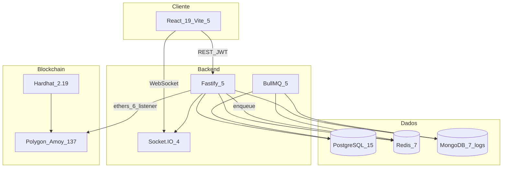

# Stack técnica — referência canônica

Documento de referência com **versões reais** extraídas dos `package.json` do repositório. Para visão arquitetural de alto nível, veja [`overview.md`](./overview.md).

*Última atualização: junho 2026 — conferir `package.json` se houver divergência.*

---

## Runtime e linguagens

| Item | Versão / detalhe | Evidência |
|------|------------------|-----------|
| Node.js | **20** | CI (`.github/workflows/test.yml`), Dockerfiles `node:20-alpine` |
| TypeScript | **^5.3.0** | `package.json` raiz |
| Target ES | **ES2022** | `tsconfig.json` raiz |
| Solidity | **0.8.26** (EVM Cancun, viaIR) | `apps/contracts/hardhat.config.cjs` |
| Bash | scripts ops | `start.sh`, `scripts/deploy-vm.sh` |

**Sem game engine** (Unity, Phaser, etc.). O cliente é uma SPA React com Canvas HTML para animações pontuais (ex.: manutenção do estádio).

---

## O que NÃO usamos

Evita confusão com reviews ou stacks de outros projetos. O MLL **não** adota:

| Tecnologia | O que usamos no lugar |
|------------|----------------------|
| **Express** | Fastify 5 — sem `express` no código nem como dep direta |
| **tRPC / SuperJSON** | REST + axios; validação via Zod em `@mll/shared` |
| **better-auth** | JWT custom (`@fastify/jwt`, refresh rotation Redis, bcrypt) |
| **TanStack Router** | React Router 6 |
| **Tailwind CSS v4** | Tailwind 3.4 + `tailwind.config.js` + PostCSS |
| **Arbitrum** | Polygon (137) e Amoy (80002) |
| **Hardhat Ignition** | `scripts/deploy.cjs` + manifests em `deployments/` |
| **Next.js** | Vite SPA (`apps/web`) |

Rate limit: `@fastify/rate-limit` com cliente **ioredis** nativo (`redis: app.redis` em [`plugins/rateLimit.ts`](../../apps/api/src/plugins/rateLimit.ts)) — não o pacote `rate-limit-redis` do ecossistema Express.

---

## Monorepo

| Item | Valor |
|------|-------|
| Gerenciador | **npm workspaces** |
| Workspaces | `packages/*`, `apps/*`, `e2e` |
| Orquestração dev | `concurrently` ^8.2.2 |
| Pacotes | `@mll/api`, `@mll/web`, `@mll/worker`, `@mll/contracts`, `@mll/shared`, `@mll/logging`, `@mll/e2e` |

---

## Diagrama da stack

---

## Dependências por workspace

### Raiz (`package.json`)

| Pacote | Versão | Uso |
|--------|--------|-----|
| typescript | ^5.3.0 | Compilação monorepo |
| vitest | ^1.6.0 | Testes unitários/integração |
| @vitest/coverage-v8 | ^1.6.0 | Coverage (threshold 80%) |
| prisma | ^5.9.0 | CLI migrations (schema em `apps/api`) |
| eslint | ^8.56.0 | Lint |
| @typescript-eslint/* | ^7.0.0 | Regras TS |
| prettier | ^3.2.0 | Formatação |
| husky | ^9.0.0 | Git hooks |
| lint-staged | ^15.2.0 | Pre-commit |
| concurrently | ^8.2.2 | `npm run dev` paralelo |

### API (`apps/api`)

| Pacote | Versão | Uso |
|--------|--------|-----|
| fastify | ^5.0.0 | HTTP server |
| @fastify/jwt | ^9.0.0 | JWT HS256 |
| @fastify/cookie | ^11.0.1 | Cookies refresh |
| @fastify/csrf-protection | ^7.0.0 | CSRF |
| @fastify/cors | ^10.0.0 | CORS allowlist |
| @fastify/helmet | ^12.0.0 | Security headers |
| @fastify/rate-limit | ^10.1.1 | Rate limiting |
| @fastify/multipart | ^9.4.0 | Uploads |
| @fastify/static | ^8.3.0 | Arquivos estáticos |
| @prisma/client | ^5.9.0 | ORM PostgreSQL |
| bullmq | ^5.8.0 | Job producer |
| socket.io | ^4.7.5 | WebSocket gateway |
| @socket.io/redis-adapter | ^8.3.0 | Multi-instância sockets |
| ioredis | ^5.3.2 | Cliente Redis (rate limit, BullMQ, Socket.IO adapter) |
| bcryptjs | ^3.0.3 | Hash senhas |
| zod | ^4.4.3 | Validação env + shared |
| ethers | ^6.16.0 | Chain listener |
| nodemailer | ^6.9.14 | Enfileiramento email |
| pino | ^9.2.0 | Logging estruturado |
| sharp | ^0.34.5 | Processamento de imagem |
| file-type | ^19.6.0 | Detecção MIME uploads |
| @sentry/node | ^9.5.0 | Error tracking (opcional) |
| @bull-board/api + fastify | ^6.7.10 | Dashboard filas (dev) |
| tsx | ^4.7.0 | Dev watch |

### Web (`apps/web`)

| Pacote | Versão | Uso |
|--------|--------|-----|
| react + react-dom | ^19.0.0 | UI |
| vite | ^5.0.0 | Bundler (porta 5173) |
| react-router-dom | ^6.21.0 | Rotas SPA |
| @tanstack/react-query | ^5.17.0 | Server state |
| axios | ^1.16.1 | HTTP client |
| tailwindcss | ^3.4.1 | Estilos |
| framer-motion | ^11.0.0 | Animações |
| i18next + react-i18next | ^23.11.5 / ^14.1.2 | i18n |
| socket.io-client | ^4.7.5 | Realtime |
| wagmi + viem | ^3.6.16 / ^2.52.2 | Web3 (fase 2) |
| @marsidev/react-turnstile | ^1.5.2 | Bot protection |
| bootstrap-icons | ^1.13.1 | Ícones |
| @testing-library/react | ^14.2.0 | Testes componentes |
| jsdom | ^24.0.0 | Ambiente DOM testes |

### Worker (`apps/worker`)

| Pacote | Versão | Uso |
|--------|--------|-----|
| bullmq | ^5.8.0 | Job consumers |
| @prisma/client | ^5.9.0 | Mesmo schema da API |
| ioredis | ^5.3.2 | Conexão filas |
| nodemailer | ^6.9.14 | Entrega SMTP |
| pino | ^9.2.0 | Logs |
| dotenv | ^16.4.5 | Carrega `.env` |
| zod | ^4.4.3 | Validação env |

### Contratos (`apps/contracts`)

| Pacote | Versão | Uso |
|--------|--------|-----|
| hardhat | ^2.19.4 | Compile, test, deploy |
| @openzeppelin/contracts | ^5.0.1 | ERC20/721, AccessControl |
| @chainlink/contracts | ^0.8.0 | VRF (ScoutEngine) |
| @nomicfoundation/hardhat-toolbox-viem | ^2.0.0 | Toolbox viem |
| viem | ^1.21.4 | Interação contratos |
| chai | ^4.5.0 | Assertions testes |
| solidity-coverage | ^0.8.17 | Coverage |
| hardhat-gas-reporter | ^1.0.10 | Gas reports |

### Shared (`packages/shared`)

| Pacote | Versão | Uso |
|--------|--------|-----|
| zod | ^4.4.3 | Schemas API ↔ Web |

### Logging (`packages/logging`)

| Pacote | Versão | Uso |
|--------|--------|-----|
| pino | ^9.2.0 | Logger factory |
| mongodb | ^6.12.0 | Sink operacional |

### E2E (`e2e`)

| Pacote | Versão | Uso |
|--------|--------|-----|
| @playwright/test | ^1.49.0 | Smoke tests |

---

## Data stores

| Store | Imagem Docker | Papel | ADR |
|-------|---------------|-------|-----|
| **PostgreSQL 15** | `postgres:15-alpine` | Source of truth — users, clubes, ledger USDC, marketplace | — |
| **Redis 7** | `redis:7-alpine` | Refresh tokens, rate limit, BullMQ, fila PvP, Socket.IO adapter | [0006](../adr/0006-refresh-token-rotation-redis.md) |
| **MongoDB 7** | `mongo:7` | Logs operacionais com TTL (não é domínio) | [0011](../adr/0011-mongodb-operational-logs.md) |

**Sem camada de cache separada** além do Redis.

---

## Integrações externas

| Serviço | Biblioteca / uso | Variáveis de ambiente |
|---------|-------------------|----------------------|
| **Cloudflare Turnstile** | Login/registro anti-bot | `TURNSTILE_SECRET_KEY`, `VITE_TURNSTILE_SITE_KEY` |
| **SMTP** | Nodemailer (worker entrega) | `SMTP_HOST`, `SMTP_PORT`, `SMTP_USER`, `SMTP_PASS`, `SMTP_FROM` |
| **Sentry** | `@sentry/node` (opcional) | `SENTRY_DSN` |
| **Pinata (IPFS)** | Uploads de imagem | `PINATA_JWT`, `PINATA_GATEWAY` |
| **Alchemy** | RPC Polygon/Amoy (Hardhat) | `ALCHEMY_API_KEY` |
| **Polygon RPC** | Chain listener API | `POLYGON_RPC_URL`, `AMOY_RPC_URL`, `CHAIN_ID` |
| **Polygonscan** | Verificação contratos | `POLYGONSCAN_API_KEY` |
| **Chainlink VRF** | Randomness on-chain (ScoutEngine) | `VRF_COORDINATOR`, `VRF_KEY_HASH`, `VRF_SUBSCRIPTION_ID` |
| **Google Analytics 4** | Analytics pós-consentimento | `VITE_GA_MEASUREMENT_ID` |
| **WalletConnect** | Web3 fase 2 | `VITE_WC_PROJECT_ID` |

Fonte completa: [`.env.example`](../../.env.example).

---

## Tooling de qualidade

| Ferramenta | Escopo |
|------------|--------|
| **Vitest** ^1.6.0 | `shared`, `logging`, `api`, `worker`, `web` via [`vitest.workspace.ts`](../../vitest.workspace.ts) |
| **Playwright** ^1.49.0 | Smoke E2E (`e2e/tests/smoke.spec.ts`) |
| **Hardhat test** | Contratos (`apps/contracts/test/`) |
| **ESLint + Prettier** | Monorepo TS |
| **Husky + lint-staged** | Pre-commit (`.husky/pre-commit`) |
| **GitHub Actions** | [`.github/workflows/test.yml`](../../.github/workflows/test.yml) — lint, typecheck, contracts, vitest, e2e |

Coverage mínimo (Vitest): 80% lines/functions/statements, 75% branches — ver `vitest.shared.ts`.

---

## Deploy e infraestrutura

| Artefato | Propósito |
|----------|-----------|
| `docker-compose.yml` | Stack prod-like (web :15000, api :3001, postgres :5433, redis :6380) |
| `docker-compose.dev.yml` | Só infra (postgres :5432, redis :6379, mongo :27017) |
| `docker-compose.vm.yml` | Overrides VM (porta 8000) |
| `apps/api/Dockerfile` | Build multi-stage API |
| `apps/worker/Dockerfile` | Build worker |
| `apps/web/Dockerfile` | Vite build → **nginx:alpine** |
| `apps/web/nginx.conf` | Proxy `/api`, `/auth`, `/socket.io`, `/uploads` |
| `scripts/deploy-vm.sh` | Deploy manual em VM |
| `start.sh` / `stop.sh` / `logs.sh` | Atalhos Docker |

Detalhes: [`../operations/docker.md`](../operations/docker.md), [`../operations/deploy.md`](../operations/deploy.md).

---

## ADRs relacionados à stack

| ADR | Decisão |
|-----|---------|
| [0001](../adr/0001-monorepo-npm-workspaces.md) | npm workspaces |
| [0002](../adr/0002-modular-monolith-fastify.md) | Fastify modular monolith |
| [0003](../adr/0003-shared-package-zod.md) | `@mll/shared` com Zod |
| [0005](../adr/0005-disable-web3-auth-phase-1.md) | Auth email-only fase 1 |
| [0006](../adr/0006-refresh-token-rotation-redis.md) | Refresh rotation Redis |
| [0007](../adr/0007-socketio-realtime.md) | Socket.IO realtime |
| [0010](../adr/0010-dedicated-worker-app.md) | Worker BullMQ separado |
| [0011](../adr/0011-mongodb-operational-logs.md) | Mongo para logs |
| [0012](../adr/0012-scout-off-chain-phase-1.md) | Scout off-chain |
| [0013](../adr/0013-env-based-admin-auth.md) | Admin via env + 2FA |
