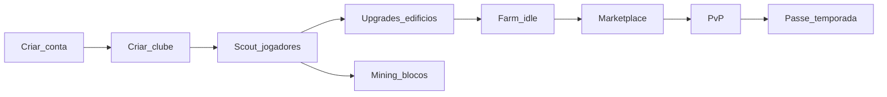

# Game design

Especificação de gameplay do MVP. Valores numéricos vêm de [`apps/api/src/config/game.ts`](../../apps/api/src/config/game.ts) — este doc referencia o código, não duplica magic numbers desatualizados.

Economia detalhada: [`tokenomics.md`](./tokenomics.md). PvP realtime: [`../architecture/realtime.md`](../architecture/realtime.md).

---

## Visão geral

**Master Legends League** é um simulador de clube de futebol em pixel-art com economia play-and-earn. O jogador:

1. Cria conta e clube
2. Scouta jogadores (gacha)
3. Evolui edifícios do clube
4. Farma USDC idle pelo overwall do elenco
5. Negocia no marketplace
6. Compete em PvP e progresso no passe de temporada
7. Participa do mining por overwall

**Fase 1:** economia off-chain em USDC (ledger Postgres). Scout server-side. Web3 desligado.

---

## Loop principal



---

## Stats dos jogadores

| Stat | Descrição | Range / valores |
|------|-----------|-----------------|
| **Overwall** | Poder do jogador — drive farm, mining, PvP | Inteiro positivo (definido no template ou roll) |
| **Raridade** | common → legendary | 0–4 (`RARITY_NAMES` em `game.ts`) |
| **Posição** | GK, DEF, MID, FW | 0–3 (`POSITION_NAMES`) |
| **Stamina** | Energia para PvP e ações | 0–100, recupera via worker (CT level) |

Jogadores off-chain: modelo `BasePlayer`. On-chain futuro: `PlayerCache` espelha NFT.

---

## Scout (gacha)

- Custo por mint: `SCOUT_COST_USDC` (ver `@mll/shared`)
- Máximo por transação: `MAX_MINT_PER_TX` (10)
- Pool: `ItemTemplate` definidos pelo admin (imagem, stats, peso)
- Distribuição de raridade: `GAME_CONFIG.RARITY_DISTRIBUTION`
- Requer email verificado
- XP passe: `PASS_XP.scoutMint` (+150)

Implementação: `ScoutService.rollFromPool()` — RNG server-side.

---

## Edifícios do clube

| Edifício | Campo Prisma | Efeito principal |
|----------|--------------|------------------|
| **Estádio** | `stadiumLvl` | Bônus farm idle (`FARM_STADIUM_BONUS` por nível) |
| **CT** | `ctLvl` | Taxa recuperação stamina |
| **Tesoureiro** | `treasurerLvl` | Progressão econômica (futuro) |
| **Sala de troféus** | `trophyRoomLvl` | Progressão / prestígio (futuro) |

**Upgrade:**
- Custo: `calculateUpgradeCost(currentLevel)` = `floor(100 × 1.5^level)`
- Nível máximo: `MAX_BUILDING_LEVEL` (de `@mll/shared`)
- Endpoint: `POST /api/club/upgrade/:building`

---

## Farm idle

Fórmula em `calculateUsdcPerHour(top11Overwall, stadiumLvl)`:

```
usdcPorHora = sumTop11(overwalls) × stadiumFactor(stadiumLvl) × FARM_OVERWALL_FACTOR
stadiumFactor = 1 + (stadiumLvl - 1) × FARM_STADIUM_BONUS
```

- Considera os **11 maiores overwalls** do elenco (`sumTop11Overwall()`)
- Acúmulo máximo offline: `FARM_MAX_OFFLINE_HOURS` (24h)
- Claim: `POST /api/club/claim-farm`
- Bônus diário: `POST /api/vestiario/rest`

---

## Marketplace

- Ativo: `BasePlayer` (off-chain fase 1)
- Taxa na venda: `MARKETPLACE_FEE_BPS` (1000 bps = 10%)
- XP passe: compra +120, venda +80
- Listagem: `POST /api/marketplace/list`
- Compra atômica: `POST /api/marketplace/buy/:id`

---

## PvP

- Matchmaking via **Socket.IO** (não HTTP)
- Formato: **best-of-5** rounds
- Servidor calcula resultado de cada round — cliente só emite `pvp:play`
- Boosters: `pvp:use-booster` com validação server-side
- Histórico persistido em `PvPMatch`
- Stamina dos jogadores impacta elegibilidade

Detalhes de eventos: [`../architecture/realtime.md`](../architecture/realtime.md).

---

## Passe de temporada

- Temporada configurável pelo admin (`Season` model)
- Duração típica: 90 dias (seed)
- XP por ações definido em `PASS_XP`
- Premium: `PASS_PREMIUM_USDC` (500 USDC)
- Níveis com recompensas (USDC ou jogador) — config JSON em `Season.levels`
- Worker desativa temporada expirada (fila `season-reset`)

---

## Mining

- Blocos periódicos distribuem USDC proporcional ao overwall total da plataforma
- Intervalo: `PlatformConfig.miningBlockIntervalMin` (default 10 min)
- Recompensa por bloco: `PlatformConfig.miningBlockRewardUsdc`
- Pode ser pausado via `PlatformConfig.miningPaused`
- Histórico: `MiningBlock`, `MiningReward`, `MiningBalance`

---

## Referrals

- Cada usuário tem `referralCode` único (8 chars)
- Bônus: `REFERRAL_BONUS_PCT` (5%) em depósitos do indicado
- Comissão processada via fila `referral-rewards`

---

## Vestiário e estádio visual

- **Vestiário:** escolher `StadiumTemplate` e posicionar jogadores (assignments JSON)
- **Estádio:** canvas de manutenção visual (HTML Canvas)
- **Loja do estádio:** itens cosméticos/efeitos compráveis com USDC

---

## Stamina

Recuperação automática pelo worker (`stamina-recovery`, cron 10 min):

```
recoveryRate = (10 + ctLvl × 2) / 6
newStamina = min(100, current + floor(recoveryRate))
```

Aplica a `BasePlayer` e `PlayerCache` (NFT).

---

## Criação de clube

- Nome único (max 32 chars)
- Bônus inicial: `STARTER_USDC` (ver `@mll/shared` / seed)
- Um clube por usuário

---

## Fora do escopo fase 1

- Auth Web3 / SIWE
- Scout on-chain com VRF
- Staking MGT on-chain
- Minigames completos (página existe como placeholder)

Ver [`dev-spec.md`](./dev-spec.md) para roadmap técnico e [`whitepaper.md`](./whitepaper.md) para visão de produto.
