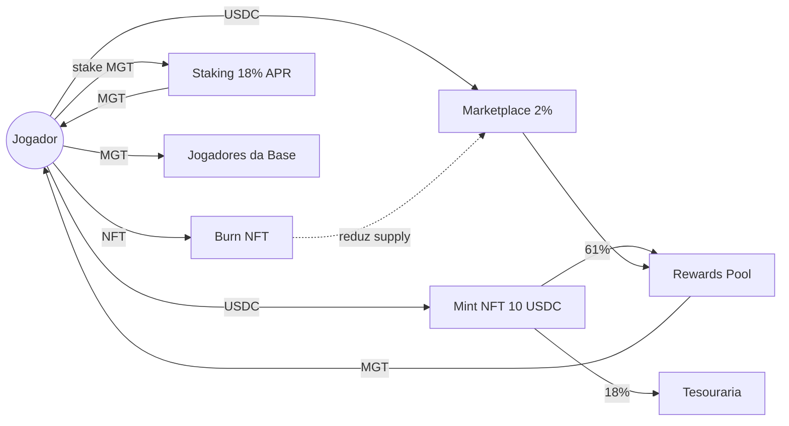

# Master Legends League — Whitepaper

**O ecossistema retrô-competitivo do futebol em NFT**

- Versão: 1.0
- Data: Junho de 2026
- Rede: Polygon
- Token oficial: MGT — Master Goal Token
- Moeda de transação: USDC

> **Disclaimer.** Este documento tem caráter exclusivamente informativo e não constitui oferta pública de valores mobiliários, instrumento financeiro ou solicitação de investimento em qualquer jurisdição. O MGT é um token de utilidade dentro do ecossistema Master Legends League e não confere direitos patrimoniais sobre a empresa emissora. Ativos digitais possuem alta volatilidade e podem resultar em perda total do capital aplicado. Cabe ao leitor verificar a legalidade da participação em sua jurisdição antes de adquirir NFTs ou tokens. Residentes em jurisdições restritas (EUA, China, Coreia do Norte, países sob sanção internacional, e demais conforme legislação aplicável) podem estar impedidos de participar.

---

## Sumário

1. [Sumário Executivo](#1-sumário-executivo)
2. [Visão e Problema de Mercado](#2-visão-e-problema-de-mercado)
3. [Produto: Master Legends League](#3-produto-master-legends-league)
4. [Tokenomics](#4-tokenomics)
5. [Modelo de Negócio](#5-modelo-de-negócio)
6. [Análise Competitiva](#6-análise-competitiva)
7. [Arquitetura Técnica](#7-arquitetura-técnica)
8. [Roadmap](#8-roadmap)
9. [Equipe e Parcerias](#9-equipe-e-parcerias)
10. [Programa de Indicações](#10-programa-de-indicações)
11. [Riscos](#11-riscos)
12. [Apêndices](#12-apêndices)

---

## 1. Sumário Executivo

**Master Legends League (MLL)** é um ecossistema Play-and-Earn de futebol retrô em Pixel Art 16-bit, construído sobre Polygon, que combina colecionismo de NFTs inspirados em lendas históricas, gestão evolutiva de clube, temporadas competitivas com PvP automatizado e uma economia deflacionária estruturada em torno do **Master Goal Token (MGT)**.

A tese central é que o mercado atual de jogos de futebol em blockchain falhou em três dimensões: (i) barreira de entrada elevada — Sorare, por exemplo, exige investimento médio acima de US$ 100 para participação competitiva; (ii) estética genérica desconectada do imaginário esportivo nostálgico; e (iii) economias inflacionárias que destroem o valor dos ativos no médio prazo por ausência de mecanismos de queima robustos. MLL responde aos três pontos com (i) entrada acessível a partir de **10 USDC por NFT** e modo **Free-to-Play** funcional, (ii) identidade visual diferenciada inspirada na era 16-bit de jogos arcade de futebol e (iii) sistema de **Burn/Fusão obrigatório** para evolução de elenco que reduz continuamente a oferta circulante.

O modelo gera receita através de quatro fluxos complementares: mintagem de NFTs (10 USDC unitários), taxa de 2% sobre transações do Marketplace, vendas do Passe Premium e distribuição de 21% da receita primária de NFTs para operações. O ecossistema é projetado para sustentabilidade de longo prazo com APR inicial de até 18% no staking de MGT, sistema de stamina que controla farm e Burn obrigatório para progressão competitiva.

**Ask de investimento.** [PLACEHOLDER — valor da rodada, valuation pre-money e percentual oferecido a ser confirmado pelo time fundador antes da distribuição deste documento.]

**Highlights**

| Métrica | Valor |
|---|---|
| Rede | Polygon |
| Token de utilidade | MGT (ERC-20) |
| NFTs | ERC-721, 5 raridades |
| Preço de mint | 10 USDC |
| Taxa de marketplace | 2% |
| APR inicial de staking | até 18% |
| Modelo de entrada | F2P + P2E híbrido |
| Capacidade máxima por clube | 100 NFTs |

---

## 2. Visão e Problema de Mercado

### 2.1. Tamanho de mercado

O setor global de jogos de futebol movimenta mais de **US$ 5 bilhões/ano** apenas em receita digital (NBA Top Shot, EA Sports FC, eFootball como referência de demanda). O segmento de Sports GameFi, embora ainda em estágio inicial, foi avaliado em **~US$ 1,2 bilhão em 2024** e projeta CAGR de 23% até 2030 (fontes públicas: Grand View Research, DappRadar). Sorare sozinha atingiu valuation de US$ 4,3 bilhões em sua última rodada Series B, validando apetite institucional pela categoria.

### 2.2. Lacunas dos incumbentes

| Problema | Estado atual do mercado |
|---|---|
| Barreira financeira | NFTs de entrada custam US$ 50–500 em Sorare/Football.fun |
| Estética | Visual fotorrealista commoditizado, sem diferenciação memorável |
| Economia inflacionária | Ausência de sinks fortes; oferta cresce indefinidamente |
| Engajamento diário | Foco em fantasy semanal, baixa retenção entre eventos |
| Onboarding F2P | Inexistente ou meramente decorativo em concorrentes |

### 2.3. Tese MLL

Master Legends League posiciona-se na intersecção de três tendências validadas: **nostalgia gamer** (sucesso de remakes 16-bit como Sea of Stars, Octopath Traveler), **GameFi sustentável** pós-colapso de modelos hiper-inflacionários (Axie 1.0) e **fan tokens esportivos**. O diferencial competitivo é a combinação inédita de F2P real + economia deflacionária + estética nostálgica num único ecossistema.

---

## 3. Produto: Master Legends League

### 3.1. Conceito e Ciclo Principal

MLL é um universo Play-and-Earn onde usuários gerenciam clubes, colecionam NFTs de jogadores lendários e competem em temporadas sazonais. O loop principal é composto por dez etapas recorrentes:

1. Monte seu clube
2. Colecione jogadores lendários
3. Aumente seu OVERWALL
4. Participe de minigames
5. Evolua suas estruturas
6. Dispute temporadas
7. Desbloqueie recompensas
8. Expanda sua torcida
9. Fortaleça seu elenco
10. Continue evoluindo seu clube

O jogo combina progressão idle, colecionismo NFT, gameplay competitivo, gestão de clube, recompensas sazonais, economia integrada e minigames diários.

### 3.2. Coleção NFT e OVERWALL

Cada NFT representa um atleta inspirado em ícones históricos do futebol. O atributo central é o **OVERWALL** — poder geral que determina produção do clube, eficiência competitiva, participação em eventos, multiplicadores especiais e ranking do elenco.

**Tabela de raridades e OVERWALL**

| Raridade | Faixa de OVERWALL | Chance no Scout |
|---|---|---|
| Comum ⭐ | 400–500 | 75% |
| Raro ⭐⭐ | 1.000–2.000 | 15% |
| Super Raro ⭐⭐⭐ | 10.000–12.000 | 7% |
| Épico ⭐⭐⭐⭐ | 50.000–62.000 | 2,5% |
| Lendário ⭐⭐⭐⭐⭐ | 250.000–312.000 | 0,5% |

A variação interna de OVERWALL dentro de cada raridade cria mercado para "perfect NFTs" — o item topo de faixa torna-se ativo premium, gerando profundidade econômica análoga a sistemas de IVs em jogos colecionáveis tradicionais.

### 3.3. Sistema de Stamina

Quanto mais utilizados, menor a eficiência, produtividade e OVERWALL temporário do atleta. Para recuperar, o usuário deve descansar jogadores, utilizar consumíveis, melhorar o Centro de Treinamento ou participar de minigames de recuperação. O sistema controla inflação, cria estratégia de rotação, aumenta retenção e equilibra o ecossistema.

### 3.4. Sistema de Clubes

Cada clube possui estrutura evolutiva composta por cinco módulos:

- **Estádio/Vestiário** — coração do clube; onde acontece o farm. Conforme evolui: aumenta capacidade de torcida, desbloqueia efeitos visuais, prestígio, bônus sazonais, arquibancadas temáticas, iluminação e cosméticos exclusivos.
- **Centro de Treinamento (CT)** — recuperação de stamina, boosts temporários, minigames. CT avançado mantém alto desempenho competitivo por mais tempo.
- **Tesoureiro** — gestão financeira e sistema de staking de MGT (até 18% APR inicial).
- **Sala de Troféus** — registro permanente de conquistas, troféus sazonais, títulos históricos.
- **Marketplace** — centro oficial de negociação de NFTs.

### 3.5. Mintagem e Scout

Onboarding via Metamask + Polygon + USDC. Cada mint custa **10 USDC** e dispara reveal cinematográfico com raridade aleatória conforme tabela 3.2. Com apenas 1 NFT o usuário já inicia farm. Eventos intermediários exigem 5 NFTs; eventos avançados exigem 11 titulares completos.

**Limite de inventário:** 1 clube oficial com 5 times completos (11 titulares + 9 reservas), totalizando **100 NFTs por clube**. O limite força utilização do sistema de Burn para progressão contínua.

### 3.6. Sistema de Burn (mecanismo deflacionário)

O coração econômico do projeto. NFTs de raridade inferior são permanentemente queimados para criar atletas superiores:

- **Off-chain (fase 1, Jogadores da Base):** 10 da mesma raridade → 1 da raridade superior (sem taxa USDC)
- **On-chain (NFT, `BurnEngine`):** 5 Comuns → 1 Raro · 5 Raros → 1 Super Raro · 5 Super Raros → 1 Épico · 5 Épicos → 1 Lendário

**Custo total de produção de 1 Lendário via fusão off-chain pura:** 10.000 Jogadores da Base Comuns. Via Burn on-chain de NFTs: 625 Comuns. Isso garante escassez estrutural das raridades superiores e cria objetivo de longo prazo para colecionadores.

### 3.7. Minigames e Passe de Temporada

Atividades diárias que concedem XP, MGT, consumíveis, boosts e jogadores da base. O **Passe de Temporada** opera em duas trilhas (Gratuito e Premium em USDC) com missões diárias, semanais e objetivos especiais. Recompensas incluem MST (Master Scout Tickets), MGT, jogadores da base, cosméticos e tickets especiais.

### 3.8. Marketplace

Negociação em USDC na Polygon com filtros por raridade, OVERWALL e traits especiais. **Taxa de 2% sobre o valor total** de cada transação alimenta o pool de sustentabilidade.

**Raridades comercializáveis e faixas iniciais estimadas**

| Raridade | Valor de mercado |
|---|---|
| Jogador da Base | Não comercializável |
| Comum | Não comercializável |
| Raro | 35–45 USDC |
| Super Raro | 180–225 USDC |
| Épico | 900–1.150 USDC |
| Lendário | 5.000–6.000 USDC |

A não-comercialização de Comuns e Jogadores da Base força fluxo via Burn, mantendo escassez nas raridades altas.

### 3.9. Free-to-Play

Acesso integral ao ecossistema sem aquisição inicial via **Jogadores da Base** (não-NFT, OVERWALL reduzido) obtidos com MGT ganho em minigames, passe e eventos. Fusão off-chain: **10 Jogadores da Base (mesma raridade) → 1 de raridade superior**. Conversão para NFT Comum on-chain permanece no roadmap (`BurnEngine`). F2P alimenta o funil de aquisição e mantém atividade total da plataforma alta.

### 3.10. PvP Competitivo

Sistema **Melhor de 5** com confronto automático por OVERWALL nas posições Goleiro → Zagueiro → Meio-Campo → Atacante → Atacante. Cada rodada vencida concede 1 ponto; vencedor da série leva 3+ pontos.

**Boosters** (1 por partida, escolha estratégica):
- Redutor Defensivo: –50% OVERWALL adversário
- Pressão Total: +30% OVERWALL próprio
- Parede Absoluta: anula booster ofensivo do adversário
- Espelho: reflete booster recebido
- Cartão Vermelho: –70% adversário / –20% próprio
- Virada Histórica: +40% se perdendo
- Torcida Organizada: –15% em todos os jogadores restantes do adversário
- Substituição de Última Hora
- Jogador Lendário: +50% OVERWALL

**Divisões ranqueadas:** Bronze → Prata → Ouro → Mundial → Lendário, com recompensas escalonadas. Stamina PvP é independente da stamina de farm, incentivando rotação de elenco.

---

## 4. Tokenomics

### 4.1. Token MGT — Master Goal Token

ERC-20 na Polygon. Utilidades dentro do ecossistema:

- Compra de Jogadores da Base
- Participação em eventos especiais
- Recompensas sazonais
- Progressão do clube
- Sistema de Stake (até 18% APR inicial)
- Recursos internos do jogo
- Pagamentos da economia Free-to-Play

### 4.2. Supply e Emissão

| Parâmetro | Valor |
|---|---|
| Supply total (hard cap) | [PLACEHOLDER — 1.000.000.000 MGT sugerido] |
| Supply inicial em circulação | [PLACEHOLDER — 8% sugerido] |
| Emissão | Linear ao longo de 60 meses via rewards pool |

### 4.3. Distribuição de Token (alocação proposta)

| Alocação | % | Vesting |
|---|---|---|
| Rewards Pool & Ecossistema (P2E/F2P/staking) | 50% | Emissão linear 60 meses |
| Tesouraria do protocolo | 15% | Multisig 3-de-5; uso governado |
| Equipe e fundadores | 15% | Cliff 12m + linear 36m |
| Advisors e parceiros estratégicos | 5% | Cliff 6m + linear 24m |
| Liquidez & Market Making | 8% | Liberação no TGE |
| Reserva estratégica e airdrops | 7% | Discricionário |

### 4.4. Distribuição da Receita de Vendas de NFTs

> Nota: a versão draft da documentação interna listava 70/21/15/5/4 (=115%). A distribuição abaixo normaliza os percentuais para 100% mantendo as proporções relativas.

| Destino | % |
|---|---|
| Rewards Pool & Ecossistema | 61% |
| Desenvolvimento & Operações | 18% |
| Marketing e Expansão | 13% |
| Liquidez & Airdrops | 4% |
| Reserva Estratégica | 4% |

### 4.5. Fluxos Econômicos (Sinks vs. Faucets)

**Faucets (entrada de MGT):**
- Recompensas de minigames
- Passe de Temporada
- PvP ranqueado
- Staking
- Airdrops e campanhas

**Sinks (saída de MGT/NFTs):**
- Burn de NFTs (queima permanente)
- Taxa de 2% do Marketplace
- Compra de Jogadores da Base
- Passe Premium (USDC)
- Mintagem (USDC)
- Consumíveis e boosts internos

### 4.6. Pricing dos NFTs

Preço primário de mint a **10 USDC** com chances tabeladas (seção 3.2). Valor esperado matemático por mint (E[valor secundário mínimo]):

E = 0,75·0 + 0,15·35 + 0,07·180 + 0,025·900 + 0,005·5.000 = **~65,4 USDC**

O EV positivo sustenta demanda por mint enquanto o limite de inventário de 100 NFTs e o sistema de Burn drenam a oferta secundária.

---

## 5. Modelo de Negócio

### 5.1. Fluxos de Receita

| Fluxo | Mecânica | Margem estimada |
|---|---|---|
| Mintagem primária | 10 USDC/NFT, 18% para Operações | 18% |
| Marketplace fee | 2% sobre GMV transacionado | ~95% |
| Passe Premium | USDC sazonal, recorrente | ~70% |
| Patrocínios in-game (Adsense) | Espaços publicitários em UI | ~80% |

### 5.2. Cenários de Projeção (12 meses pós-launch)

| Cenário | Usuários ativos | NFTs mintados | GMV marketplace | Receita anual |
|---|---|---|---|---|
| Conservador | 10.000 | 150.000 | US$ 2 mi | ~US$ 310 k |
| Base | 50.000 | 800.000 | US$ 18 mi | ~US$ 1,8 mi |
| Otimista | 200.000 | 4.000.000 | US$ 90 mi | ~US$ 8,5 mi |

> Projeções baseadas em premissas conservadoras de média de 15 mints/usuário/ano e churn de 35%. Não constituem garantia de performance futura.

### 5.3. Unit Economics

- **CAC**: principalmente via Programa de Indicações (5% do farm dos referidos), reduzindo CAC pago para ~US$ 3–5 estimado.
- **LTV** (cenário base): US$ 36 médio em 12 meses considerando mint inicial + passes + marketplace.
- **Payback**: < 2 meses por usuário pago.

---

## 6. Análise Competitiva

| Critério | Sorare | Football.fun | Striker Manager | **MLL** |
|---|---|---|---|---|
| Entrada F2P real | ❌ | Parcial | ❌ | ✅ |
| Preço de entrada | US$ 50+ | US$ 100+ | Gratuito (Web2) | **10 USDC** |
| Mecânica de Burn | ❌ | ❌ | N/A | ✅ obrigatório |
| Estética diferenciada | ❌ fotorrealista | ❌ fotorrealista | ❌ | ✅ Pixel Art 16-bit |
| PvP automatizado | Fantasy semanal | Fantasy | Sim | ✅ Melhor de 5 |
| Stake nativo | ❌ | ❌ | N/A | ✅ até 18% APR |
| Rede | Ethereum/StarkNet | Solana | Web2 | Polygon |

**Posicionamento:** MLL ocupa o quadrante "barreira baixa + economia deflacionária + identidade visual diferenciada" — atualmente vazio no mercado.

---

## 7. Arquitetura Técnica

### 7.1. Infraestrutura

- **Rede principal:** Polygon PoS — gas baixo (<US$ 0,01 por tx), suporte nativo a USDC, EVM-compatível.
- **Smart contracts:**
  - `MLLPlayerNFT` — ERC-721 com metadata on-chain dos atributos OVERWALL, raridade, stamina.
  - `MGTToken` — ERC-20 padrão com mint controlado por rewards contract.
  - `BurnEngine` — agregador de fusões 5→1.
  - `Marketplace` — order book com fee de 2%.
  - `StakingVault` — pool de staking com APR variável.
- **Carteira suportada:** Metamask (V1), WalletConnect e social login Account Abstraction (V2).
- **Metadados:** IPFS com pinning redundante (Pinata + Filecoin).

### 7.2. Aleatoriedade

Sistema de Scout utiliza **Chainlink VRF v2** para garantir randomização verificável de raridades, eliminando suspeita de manipulação.

### 7.3. Segurança

- Auditoria externa antes do TGE (alvos: CertiK, Hacken ou Quantstamp).
- Multisig Gnosis Safe 3-de-5 na tesouraria.
- Timelock de 48h para upgrades de contratos.
- Bug bounty público pós-launch (Immunefi).

### 7.4. Off-chain

Backend Node.js + PostgreSQL para estados de gameplay não-críticos (stamina, minigames, ranking PvP). Reconciliação on-chain de eventos econômicos (mint, burn, marketplace).

---

## 8. Roadmap

| Trimestre | Marcos |
|---|---|
| **Q3 2026** | TGE de MGT, mint inicial dos NFTs Comuns–Lendários, lançamento mainnet do clube, F2P básico |
| **Q4 2026** | PvP Melhor de 5 ativo, Marketplace público, sistema de Burn em produção, primeira temporada |
| **Q1 2027** | Passe de Temporada S1, divisões ranqueadas completas, sistema de Stake operacional |
| **Q2 2027** | Expansão internacional (LATAM → EU → APAC), versão mobile, parcerias com clubes reais |
| **Q3 2027+** | Governança descentralizada (MLL DAO), ligas comunitárias, segunda coleção temática |

---

## 9. Equipe e Parcerias

[PLACEHOLDER — substituir por bios reais do time fundador, advisors e parceiros confirmados.]

- **CEO / Fundador:** [Nome, breve trajetória]
- **CTO:** [Nome, experiência Web3]
- **Head of Game Design:** [Nome]
- **Head of Tokenomics:** [Nome]
- **Advisors:** [Nomes confirmados]
- **Parcerias estratégicas:** [a confirmar]

---

## 10. Programa de Indicações

Cada usuário recebe código exclusivo de indicação. Recompensas:

- MGT bonus
- **5% do farm dos referidos** (perpetuamente, enquanto ativos)
- Boosts temporários
- Recompensas especiais de eventos

**Atividades válidas:** mintagem, participação em eventos, progressão no passe, PvP, atividade contínua.

**Sistema anti-abuso:** detecção de contas múltiplas, padrões fraudulentos, perda de recompensas, banimento do programa.

**Ranking de Indicações:** top indicadores recebem recompensas exclusivas, cosméticos especiais e reconhecimento dentro da League.

---

## 11. Riscos

| Categoria | Risco | Mitigação |
|---|---|---|
| **Regulatório** | Classificação do MGT como security em jurisdições específicas (SEC, CVM) | Estruturação como utility token; restrição geográfica; assessoria jurídica especializada |
| **Técnico** | Vulnerabilidades em smart contracts | Auditoria externa pré-launch, bug bounty, timelock, multisig |
| **Mercado** | Volatilidade cripto reduz demanda por NFTs | USDC como moeda primária neutraliza volatilidade no onboarding |
| **Competitivo** | Entrada de Sorare/EA em segmento similar | Vantagens de first-mover em Pixel Art GameFi, comunidade engajada |
| **Dependência de infraestrutura** | Outage da Polygon | Arquitetura preparada para migração L2 cross-chain |
| **Tokenômico** | Inflação de MGT por excesso de farming | Sistema de stamina, Burn obrigatório, sinks múltiplos calibrados |
| **Operacional** | Execução do roadmap | Equipe sênior, milestones públicos, transparência on-chain |

---

## 12. Apêndices

### 12.1. Glossário

- **OVERWALL** — atributo numérico que representa o poder geral de um atleta NFT.
- **MGT** — Master Goal Token, moeda de utilidade do ecossistema.
- **MST** — Master Scout Tickets, ingressos para mints especiais.
- **Scout** — sistema oficial de mintagem de NFTs.
- **Burn** — fusão permanente de NFTs para criação de raridade superior.
- **Stamina** — energia limitada por NFT que controla uso.
- **Jogador da Base** — entidade F2P não-NFT.
- **Passe de Temporada** — trilha de progressão sazonal com recompensas.

### 12.2. Tabelas de Referência Rápida

**Raridades:**

| Raridade | OVERWALL | Chance | Valor mercado |
|---|---|---|---|
| Comum | 400–500 | 75% | Não negociável |
| Raro | 1.000–2.000 | 15% | 35–45 USDC |
| Super Raro | 10.000–12.000 | 7% | 180–225 USDC |
| Épico | 50.000–62.000 | 2,5% | 900–1.150 USDC |
| Lendário | 250.000–312.000 | 0,5% | 5.000–6.000 USDC |

**Burn:**

| Origem | Resultado |
|---|---|
| 10 Jogadores da Base (off-chain) | 1 Jogador da Base (raridade+1) |
| 5 Comuns (on-chain NFT) | 1 Raro |
| 5 Raros | 1 Super Raro |
| 5 Super Raros | 1 Épico |
| 5 Épicos | 1 Lendário |

### 12.3. Canais Oficiais

- Website: [a confirmar]
- Twitter/X: [a confirmar]
- Discord: [a confirmar]
- Telegram: [a confirmar]
- Contratos verificados: [Polygonscan links pós-deploy]

---

*Master Legends League — Na League, toda lenda começa pequena. Mas apenas os maiores clubes conseguem alcançar a eternidade.*
